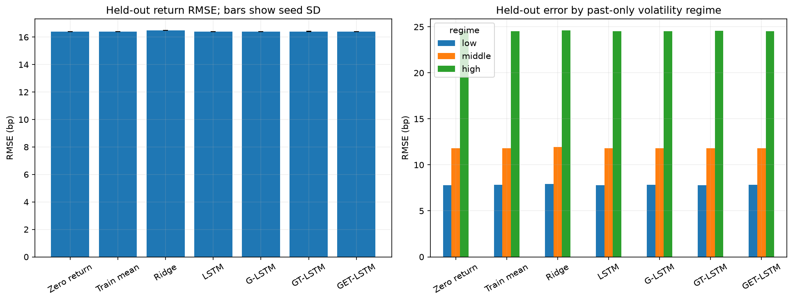
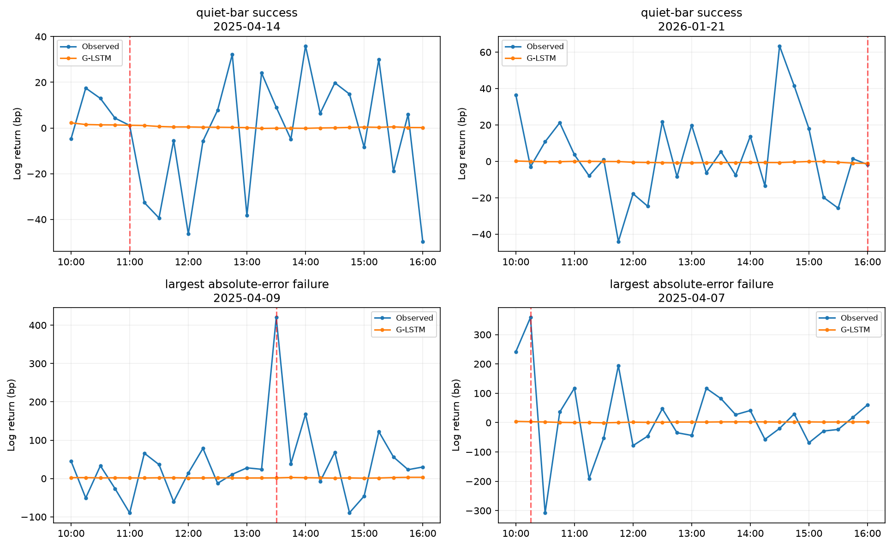
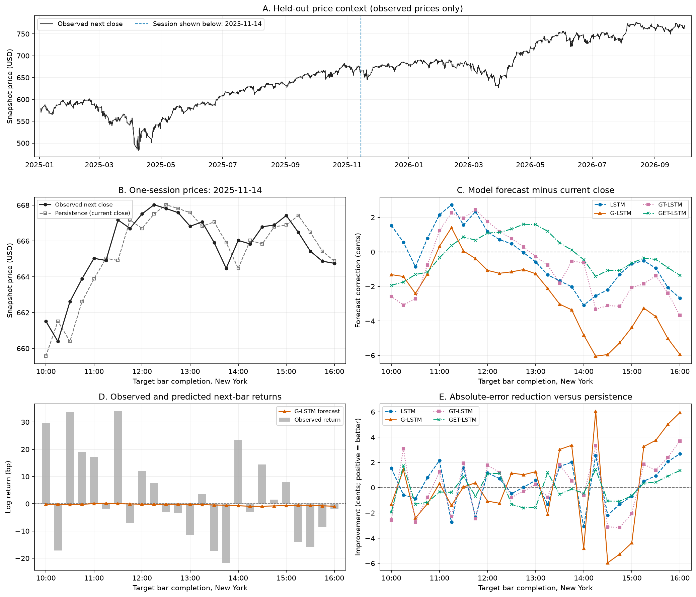
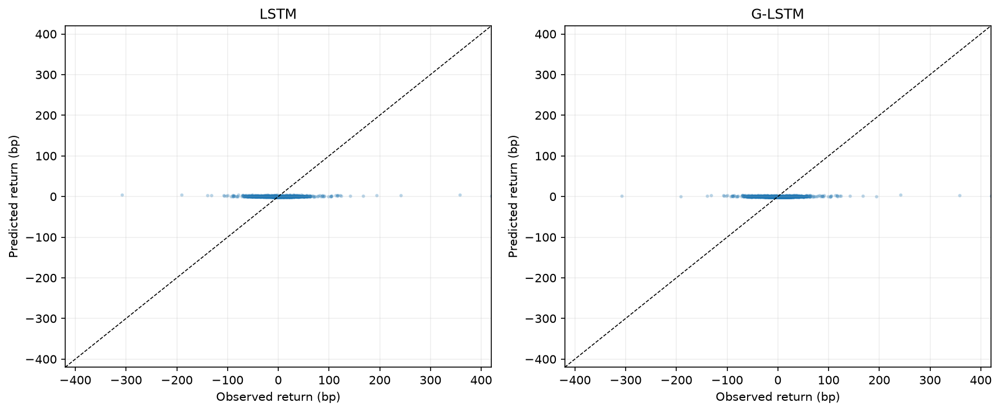

# Check-in 2 — LSTM Baseline Results and Failure Analysis

## Scope and reproducible setup

This check-in implements a step-by-step forecasting pipeline on SPY: data cleaning and log returns, rolling GARCH-family estimates, sliding-window inputs, a small PyTorch LSTM, held-out prediction, and visualization. All pipeline code is in [scripts/02_lstm_garch_baseline.ipynb](scripts/02_lstm_garch_baseline.ipynb). The notebook was executed from top to bottom; results below are measured outputs, not expected results.

The pipeline uses rolling volatility-model features, a two-layer LSTM with a linear head, MSE/Adam training, and observed-versus-predicted plots. Normalization is fitted only on training data, and labels are aligned by timestamp. As established in Check-in 1, the target is the **next within-session 15-minute log return**, with a reconstructed next close for a secondary price-based evaluation.

- **Data:** supplied SPY snapshot; 169,241 raw bars, 69,973 regular-session bars, one missing expected regular-session bar, January 2016–September 30, 2026. Extended hours, overnight transitions, and missing-bar transitions are excluded as targets; no missing bar is filled.
- **Matched samples after warm-up:** 41,368 training origins from May 2016–2022, 12,490 validation origins in 2023–2024, and **10,889 held-out origins** in 2025–September 2026. All models use the same origins. Histories may include earlier sessions with explicit boundary flags.
- **LSTM:** 26-bar input window, 2 layers, 32 hidden units, dropout 0.1, one linear output, MSE, Adam at 0.001, batch size 256, maximum 20 epochs, validation early stopping with patience 4, CPU. Runs stopped after 5–10 epochs. Seeds: 42, 123, 2026. There was no architecture/hyperparameter search.
- **GARCH:** zero-mean Student-t GARCH(1,1), GJR-GARCH(1,1), and EGARCH(1,1); 100 prior trading sessions per fit; refit before each session and update state using completed returns. GJR-GARCH is the explicitly specified asymmetric variance model used for the threshold-feature comparison.
- **Evaluation:** neural weights/scalers stay frozen during testing; GARCH fits can use earlier observed test-period returns. Validation selects stopping epochs and representative plotting seeds. Test data never selects hyperparameters, epochs, or representative seeds.

`data/results/config.json`, `run_manifest.json`, and `data_manifest.json` record the exact setup. The original feed and corporate-action adjustment cannot be proven from this snapshot; this limitation remains from Check-in 1.

## 1. Results

### Quantitative metrics on the held-out set

**The neural variants essentially tie zero-return persistence. G-LSTM has a marginally lower mean RMSE (16.405379 versus 16.405443 bp), a difference of only 0.000064 bp. This tiny point-estimate advantage does not establish a meaningful forecasting improvement.** The core G-LSTM has 0.001% lower mean RMSE than the plain LSTM. This is a baseline experiment; adding volatility inputs is an empirical hypothesis rather than an assumed improvement.

| Model | Test RMSE (bp), mean ± seed SD | MAE (bp) | R² vs zero | Direction accuracy | Price RMSE (USD) |
| --- | ---: | ---: | ---: | ---: | ---: |
| Zero return | 16.4054 | 9.7478 | 0.00000 | 0.00% | 0.9739 |
| Train mean | 16.4053 | 9.7472 | 0.00002 | 51.15% | 0.9739 |
| Ridge | 16.5031 | 9.8809 | -0.01195 | 49.88% | 0.9811 |
| LSTM | 16.4055 ± 0.0025 | 9.7477 | -0.00001 | 51.08% | 0.9740 |
| G-LSTM | 16.4054 ± 0.0044 | 9.7501 | 0.00001 | 50.33% | 0.9740 |
| GT-LSTM | 16.4100 ± 0.0060 | 9.7545 | -0.00056 | 49.60% | 0.9742 |
| GET-LSTM | 16.4065 ± 0.0016 | 9.7519 | -0.00012 | 49.80% | 0.9740 |

One basis point is 0.0001 log-return units. Neural entries average the metric over three runs; SD describes variation across seeds and is not a confidence interval. Persistence, training mean, and ridge are deterministic single runs. R² is `1 - sum((y-yhat)^2)/sum(y^2)`, so a negative value is worse than zero-return persistence. Price RMSE is in the supplied snapshot's price scale.

Directional accuracy excludes 70 exactly zero targets and uses 10,819 remaining targets. An exactly zero prediction counts as incorrect for a nonzero target; persistence therefore has 0% under this convention and makes no directional forecast. The training-majority direction obtains **51.15%** on the same nonzero test targets, which is a more informative directional reference than 50% alone.

### Ablation: adding GARCH-family inputs

The matched progression is **LSTM → G-LSTM → GT-LSTM → GET-LSTM**, with 10, 15, 21, and 27 input features respectively. G-LSTM adds GARCH forecast log variance, standardized residual, rolling alpha/beta, and a fallback flag. GT-LSTM adds the GJR bundle; GET-LSTM also adds the EGARCH bundle. These ablations test progressively larger feature bundles, rather than an isolated causal effect of model family or a parameter-count-matched architecture.

| Hybrid minus LSTM | Mean MSE difference (bp²) | 95% trading-day bootstrap interval |
| --- | ---: | --- |
| G-LSTM minus LSTM | -0.00424 | [-0.21773, 0.21240] |
| GT-LSTM minus LSTM | 0.14816 | [-0.14190, 0.44660] |
| GET-LSTM minus LSTM | 0.03131 | [-0.43514, 0.57588] |

Intervals use 2,000 whole-trading-day bootstrap draws, averaging paired per-origin loss differences over seeds and retaining each day's full set of bars. Negative differences favor the hybrid. All three intervals include zero, so this run provides no clear evidence of a hybrid improvement over the plain LSTM. These descriptive intervals are not adjusted for multiple comparisons.

Annual results are:

| Model | 2025 RMSE (bp) | 2026 through September RMSE (bp) |
| --- | ---: | ---: |
| Zero return | 18.8881 | 12.3560 |
| LSTM | 18.8875 | 12.3574 |
| G-LSTM | 18.8848 | 12.3626 |
| GT-LSTM | 18.8923 | 12.3616 |
| GET-LSTM | 18.8871 | 12.3612 |

### Qualitative examples: successes and failures

The focal qualitative model is G-LSTM, fixed in advance. Its plotting seed is **123**, chosen by validation RMSE. The two quiet-bar successes have correctly signed returns of at least 1 bp, absolute forecast error at most 1 bp, and error reduction versus persistence of at least 1 bp; choose the two smallest errors among these illustrative easy cases. The two failures have the largest test absolute errors. For the separate tail-error analysis, the **training** 95th-percentile absolute-return threshold is 33.008 bp. These examples are selected after evaluation to illustrate behavior, not to estimate overall performance.

| Example selection | Forecast origin (New York, completed bar) | Observed next return (bp) | G-LSTM forecast (bp) | Absolute error (bp) | Error reduction vs zero (bp) |
| --- | --- | ---: | ---: | ---: | ---: |
| quiet-bar success | 2025-04-14 10:45 | 1.125 | 1.206 | 0.081 | 1.044 |
| quiet-bar success | 2026-01-21 15:45 | -1.765 | -1.106 | 0.659 | 1.106 |
| largest absolute-error failure | 2025-04-09 13:15 | 420.038 | 1.689 | 418.349 | 1.689 |
| largest absolute-error failure | 2025-04-07 10:00 | 358.365 | 3.104 | 355.261 | 3.104 |

The two successes show that small nonzero movements can occasionally be predicted accurately. They were selected after evaluation and do not establish reliable performance across ordinary bars. Both selected failures have the correct sign but miss almost the entire realized move, illustrating the difference between direction and magnitude accuracy.

The red vertical line marks the selected forecast's target completion. The full session provides context; only observations available before the marked forecast contribute to its input.

Panel A shows the full-period observed price context. Panels B–E use a full trading session at the chronological midpoint of the test sessions, selected without examining model errors. Panel B compares the observed next close with last-close persistence. Panel C plots each model's forecast correction to the current close in **cents**, making small model differences visible. Panel D keeps observed and predicted returns on the same basis-point scale. Panel E reports the reduction in absolute price error versus persistence; positive values favor the model. All one-step price forecasts remain anchored to the **observed current close**, so price tracking alone does not establish useful return predictability. The models, selected seeds, and reported test metrics are unchanged.

## 2. Failure analysis

### What breaks and why

1. **Forecasts shrink toward the mean and miss large moves.** For the validation-selected G-LSTM seed, predicted-return standard deviation is 2.35% of observed test-return standard deviation. On 440 test targets above the training 95th-percentile move threshold, G-LSTM RMSE is 63.071 bp. The nearly flat scatter is consistent with weak directional signal under an MSE objective: zero-like forecasts can score well while failing to anticipate individual jumps. This is a behavioral diagnosis, not proof of a single causal mechanism.
2. **Errors grow with market volatility.** For G-LSTM, RMSE rises from 7.815 bp in the low-volatility group to 24.548 bp in the high-volatility group. GARCH estimates conditional uncertainty; it does not supply the sign of the next shock. Adding variance and coefficient features does not guarantee a better conditional-mean forecast.
3. **The model comparison is sensitive to initialization and feature bundles.** Three seeds and the paired intervals describe the uncertainty of the small observed differences. No broad tuning was performed, and adding families also increases input dimensionality. The present experiment cannot isolate whether a difference comes from a particular family, extra features, or optimization variability.
4. **The session and volatility treatment is intentionally simple.** Daily refits use concatenated within-session returns; there is no explicit intraday seasonal variance model, and variance state is carried across boundaries. This can leave systematic open/close behavior unmodeled. Across 7,803 daily family fits, 8 failed (2 GARCH, 6 GJR, 0 EGARCH); all use a logged past-only variance fallback and remain in the dataset. No numerical update guard was triggered. These occasional fit failures are an implementation limitation, not an established explanation for all forecast errors.

Volatility groups use trailing-volatility cutoffs fitted on training inputs (7.623 and 13.989 bp):

| Model | Low-volatility RMSE (bp) | Middle RMSE (bp) | High RMSE (bp) |
| --- | ---: | ---: | ---: |
| Zero return | 7.811 | 11.810 | 24.549 |
| LSTM | 7.811 | 11.808 | 24.550 |
| G-LSTM | 7.815 | 11.809 | 24.548 |
| GT-LSTM | 7.807 | 11.814 | 24.557 |
| GET-LSTM | 7.816 | 11.814 | 24.547 |

### What I will try next for Check-in 3

1. **Tune the existing LSTM on validation folds:** compare 26/52/100-bar windows, a small hidden-size/layer grid, and learning rates. Compare MSE with Huber loss, and inspect tail errors alongside aggregate RMSE. Keep the baseline files and metrics as a fixed reference.
2. **Separate the volatility-feature ablations:** compare variance-only, residual-only, coefficient-only, and combined features. Test training-fitted intraday deseasonalization before adding more GARCH families or attention.
3. **Evaluate adaptation and a longer horizon:** compare a fixed network with a predeclared expanding-window retraining schedule, and assess 30/60-minute targets or a distinct variance-forecasting task. Report return and volatility forecasts separately.
4. **Protect the next evaluation:** perform changes using validation or nested chronological folds. The 2025–September 2026 test has now been examined; reserve newly collected later data as a new untouched evaluation slice before making stronger performance claims.

This check-in intentionally stops at a readable, reproducible LSTM baseline. It does not optimize a final model or claim trading profitability.

## Files and verification

- [Executed pipeline](scripts/02_lstm_garch_baseline.ipynb): all data processing, model training, metrics, and plotting code in one notebook.
- `data/intermediate/`: cleaned bars, causal market/GARCH features, fit log, scaled sequences, sample timestamps, and scaler values.
- `data/models/`: all 12 LSTM checkpoints and ridge coefficients.
- `data/results/`: per-run and summarized metrics, validation/test predictions, training histories, paired bootstrap intervals, regime/year metrics, and selected example rows.
- `visualizations/`: six exported figures, including training EDA and loss curves.
- [Pinned baseline environment](requirements-baseline.txt): Python 3.12.14, PyTorch 2.15.0, `arch` 8.0.0.

Verification includes a clean-kernel top-to-bottom execution, timestamp/target ordering, training-only normalization, matched sample counts, finite predictions, unchanged source checksum, and checks that each GARCH-family recursive forecast agrees with `arch` and is invariant to truncating later observations from the current session. All reported tables are derived from saved outputs.

References: [arch volatility modeling](https://arch.readthedocs.io/en/stable/univariate/univariate_volatility_modeling.html), [PyTorch LSTM](https://docs.pytorch.org/docs/stable/generated/torch.nn.LSTM.html). Codex assisted with implementation, execution, and drafting this report.
